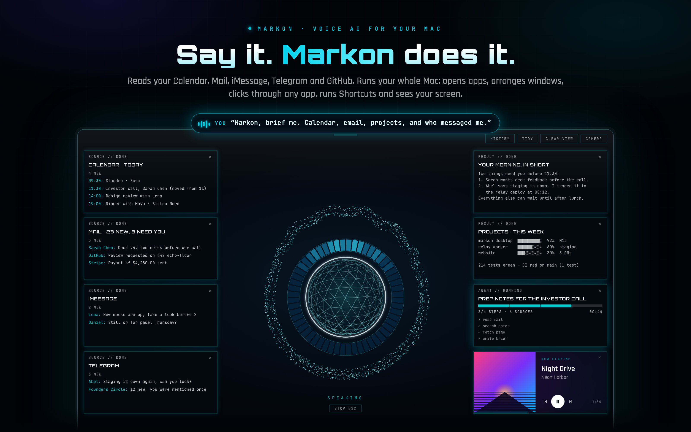

# Markon



A desktop voice assistant for macOS. You talk, it answers out loud, and the work it does shows up as cards
around an animated voice core. Built with Tauri 2: a Rust core and a React interface.

**Status: alpha.** Most features are tested against fakes (a scripted model, mock servers, a fake Mac), not
against real accounts and hardware. Expect rough edges.

## What it does

- **Talk and listen.** Push-to-talk (Alt+Space by default) or a wake phrase. Speech-to-text (whisper.cpp) and
  the default voice (Kokoro) run on your Mac. You can talk over a reply to interrupt it.
- **Act with approval.** Read and write files in folders you approve, run commands, control apps and system
  settings, drive a browser, send mail and messages. Anything that changes something asks first.
- **Know your stuff.** Optional sources (mail, iMessage, Calendar, Notes, GitHub, MCP servers), memory of
  what you tell it, search over approved folders. Every source starts switched off.
- **Scheduled agents and skills** as plain files in `~/.markon/`.

## Requirements

- A Mac with Apple Silicon, macOS 13 or later. Windows and Linux are not supported.
- Developed and measured on an M1 Pro with 32 GB. Slower or 8 GB Macs are untested.
- About 250 MB of disk for the speech models, plus 1.1 GB if you choose the built-in language model.
- A model to think with. One of:
  - an Anthropic API key (the default),
  - Claude Code installed and signed in,
  - an OpenRouter key,
  - a local server such as Ollama or LM Studio (experimental),
  - the built-in small model (experimental, on-demand download).

## Build and run

There are no prebuilt downloads yet. You build from source.

```bash
brew install cmake meson ninja pkgconf
```

Install Rust through [rustup](https://rustup.rs) (the version comes from `rust-toolchain.toml`), Node 24.16.0
and pnpm 12.4.2. Then:

```bash
pnpm install
```

```bash
pnpm --filter @markon/desktop tauri dev
```

The first build compiles whisper.cpp, llama.cpp and WebRTC's audio library and takes several minutes. On
first launch Markon downloads the speech models listed in [models/manifest.json](models/manifest.json) to
`~/.markon/models` and checks each file's SHA-256. A file that does not match is refused. There is no
fallback voice.

macOS will ask for the microphone. Other permissions (Accessibility, Screen Recording, Automation, Full Disk
Access) are asked for only when you use a feature that needs them.

## Privacy

Markon has no telemetry, analytics, crash reporting or update checks.

| What                                                 | Where it goes                                                                                                                                                                 |
| ---------------------------------------------------- | ----------------------------------------------------------------------------------------------------------------------------------------------------------------------------- |
| Microphone audio                                     | Transcribed on your Mac. Not stored, not uploaded. Once the speech models load, the microphone stays open to hear the wake phrase, and that audio is checked on your Mac too. |
| What you said, tool results, screenshots you ask for | The model route you chose: Anthropic, OpenRouter, Claude Code, or a local model.                                                                                              |
| Reply text                                           | Stays local with the Kokoro voice. Sent to Cartesia only if you pick the online voice.                                                                                        |
| Mail, messages, calendar, notes                      | Read locally. In "what did I miss", private sources are summarised by a local model or left out. Search results from them reach the model you chose.                          |
| API keys and tokens                                  | macOS keychain only (service `com.markon.desktop`).                                                                                                                           |
| History, memory, cards, traces                       | A plain SQLite database in `~/.markon`. It is not encrypted.                                                                                                                  |

It is **not** fully offline by default: the default model is a cloud one. For a local-only setup, choose a
local server or the built-in model and keep the Kokoro voice.

## Safety model

Markon can control your Mac, so every tool sits in a tier:

- **Read**: only inside folders you approved. Secret files (`.env`, keys) are always refused.
- **Write**: asks once per folder.
- **Execute** (commands, MCP tools, app control): asks every time and shows exactly what will run.
- **Send** (mail, messages, calendar): asks with the exact text. For a message to one person you can
  answer "always yes", which stops applying once the conversation has read outside content.

You can answer a Send prompt by voice. Execute and Write prompts need a click. A spoken "no" always works.

Known gaps: fetching a web page or opening a URL does not ask, so text injected by a web page or an email
could make the model request an attacker's URL. Approving a folder for writing covers dotfiles in it.
Items from private sources are searchable, and search results go to the model you chose. Treat approved
folders and connected sources accordingly.

## Known limitations

- The full live loop (microphone to spoken reply) and interruption at high speaker volume have not been
  verified end to end.
- Following a change of audio device (for example connecting AirPods) is not handled.
- "Stop" stops running tools, but a Mac control action (AppleScript) that has already started still finishes.
- Web search exists on the Anthropic route only.
- The free-trial relay in `services/relay` is not deployed.
- English only.

## Repository layout

```
apps/desktop/            Tauri app: src-tauri (Rust shell) + src (React interface)
packages/voice-core/     the animated voice core, a standalone React component
crates/                  Rust crates: audio, agent, provider, platform, tools, memory, scheduler, sources, llm, hands, evals
services/relay/          Cloudflare Worker for a free trial (not deployed)
models/manifest.json     model and voice files: url, size, SHA-256, licence
docs/                    how Markon works, see below
```

## Documentation

- [Architecture](docs/architecture.md): the crates, the app shell and how a request flows
- [Voice](docs/voice.md): listening, speech to text, voices and talking over Markon
- [Agent and tools](docs/agent-and-tools.md): the agent loop, tool tiers, approvals and cards
- [Models](docs/models.md): model routes, private routing and pinned model files
- [Sources and memory](docs/sources-and-memory.md): connected sources, memory and search
- [Automation](docs/automation.md): agent files, skills, reminders and the watch agent
- [Security](docs/security.md): the safety model, guards and known gaps
- [Development](docs/development.md): building, checks and tests

## Checks

All of these must pass before a change is merged:

```bash
cargo clippy --workspace --all-targets -- -D warnings
cargo test --workspace
cargo deny check
pnpm -r typecheck
pnpm biome check .
pnpm -r test
pnpm --filter @markon/voice-core e2e
pnpm --filter @markon/desktop e2e
pnpm --filter @markon/relay test
```

Tests never call a real model API. They use the faked provider.

## Models

Markon ships no model files. It downloads these, pinned by hash:

| Model                              | Use                               | Licence    |
| ---------------------------------- | --------------------------------- | ---------- |
| whisper.cpp base.en                | speech to text                    | MIT        |
| Kokoro-82M (q8f16) with two voices | text to speech                    | Apache-2.0 |
| misaki dictionaries                | pronunciation                     | Apache-2.0 |
| Silero VAD                         | detecting speech for interruption | MIT        |
| Qwen2.5 1.5B Instruct (optional)   | built-in language model           | Apache-2.0 |
| all-MiniLM-L6-v2 (optional)        | search by meaning                 | Apache-2.0 |

Markon adds no content filter of its own. What the assistant will or will not say depends on the model you
connect.

## Licence

Apache-2.0. See [LICENSE](LICENSE). Third-party components are credited in
[NOTICE](NOTICE).
